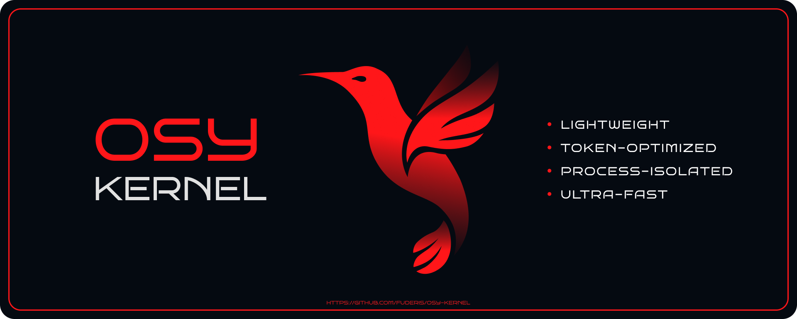
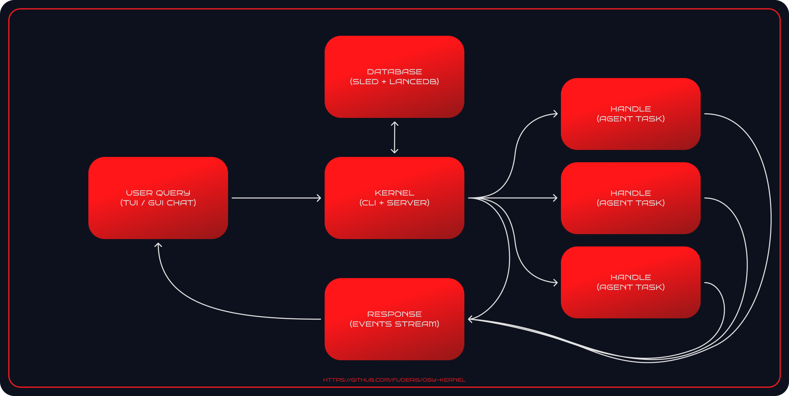

<p align="center">
  
</p>

<h1 align="center">Osy Kernel</h1>
<p align="center">
  <strong>Deterministic, Token-Efficient AI-Powered Toolkit Engine</strong><br>
  <code>microservice-architecture</code> • <code>process-isolated</code> • <code>token-efficient</code>
</p>



**Osy** is an open-source, AI-powered toolkit engine written in Rust. It bridges the Unix philosophy with embedded artificial intelligence, treating skills as lightweight, atomic CLI utilities operating over lightning-fast IPC.

Unlike traditional agentic frameworks that suffer from uncontrolled agent autonomy, runaway token usage, and heavy context pollution, Osy solves these issues at the system level. Orchestration happens in a clean chat loop or via direct CLI execution. Agent tasks run in isolated processes with zero access to the user context, and only sanitized, scrubbed final outputs are fed back.

> ⚠️ **EXPERIMENTAL:** Osy is under active evolution with rapid refactoring of IPC contracts and internal pipelines.
> 
> **RAM Warning:** Embedded databases (LanceDB & Sled) run directly inside the kernel process and may consume significant RAM and I/O under heavy workloads.

---

## Key Features

- **Microservice Agent Isolation:** Agents run as lightweight IPC servers. Every skill execution runs in its own isolated context without cluttering the main conversation history.

- **Extreme Token Scrubbing:** Technical payloads, raw JSONs, and tool calls never leak into the main dialogue. You pay only for meaningful orchestrator interactions.

- **Dual-Mode Execution (CLI & AI Chat):** Run skills directly via `osy do` with zero token overhead, or enter interactive AI chat mode (`osy chat`) when natural language orchestration is needed.

- **Deterministic Star Topology:** Agents are strict executors managed directly by the Kernel. They cannot spam each other or trigger infinite recursive loops.

- **Zero-Overhead IPC & SSE Transport:** Communication moves strictly over Unix Domain Sockets (or Named Pipes for Windows) via native streaming protocols, avoiding HTTP network stack bloat.

- **Interactive Dialog Protocol:** Rich kernel-managed runtime events (`Dialog`) supporting user prompts, secret inputs, confirmation checks (`y/n`), select menus, and script execution approvals with timeout controls.

- **Smart Hybrid Memory (RAG + Context Injection):** Automatic pre-fetching of relevant facts before prompt assembly, plus explicit model-driven vector queries when needed.

- **Embedded JS Engine (Boa Runtime):** Safe, deterministic math, data filtering, and scripting executed in a sandboxed JavaScript runtime inside the process.

- **Self-Healing Loop:** Automatic process recovery and prompt correction on invalid model outputs without breaking the main user session.

---

## Official Extensions

- **[osy-system](https://github.com/fuderis/osy-system.git): Local system management agent** — Provides system metrics, appearance changing, power & media control, disks & infrastructure management.

---

## Architecture & Ecosystem

Osy utilizes a centralized orchestration model:



### Ecosystem of Specialized Rust Crates:

- **Rigging:** Asynchronous inline TUI engine for reactive terminal UI (Markdown, syntax highlighting, Vi/Vim keybindings, and dynamic viewports).

- **AnyLM:** Unified SDK layer for seamless operation across any model provider (OpenAI, Anthropic, Ollama, Local vLLM).

- **Cistern:** High-level async abstraction built on top of Sled (fast KV store) and LanceDB (embedded vector DB).

- **Pearce:** Axum-based networking engine with native UDS client and SSE streaming support.

- **Atoman:** Thread-safe management of asynchronous state and kernel configurations.

- **Boa JS:** Embedded lightweight JavaScript interpreter for deterministic computations without invoking external processes.

---

## Interactive Dialog Events

Osy features a robust inter-process dialog protocol enabling safe, interactive interventions during execution:

```rust
enum Dialog {
    Script { id: String, code: String, use_sudo: bool },
    Confirm { id: String, prompt: String, default: Option<Confirmation> },
    Prompt { id: String, prompt: String, placeholder: Option<String>, default: Option<String>, multiline: Option<bool> },
    Secret { id: String, prompt: String, placeholder: Option<String> },
    Select { id: String, prompt: String, items: Vec<String> },
}
```

---

## Hybrid RAG & Smart Memory

Memory in Osy is split across several managed layers:

| Mechanism | Description |
| --- | --- |
| **Auto-Trigger Memory** | The kernel scans incoming context and automatically pulls relevant embeddings from LanceDB before sending the request to the LLM. |
| **Explicit Model Pull** | The model can initiate memory calls (`search_fact`, `remember_fact`) on its own if it lacks sufficient data for an accurate response. |
| **Dynamic System Prompts** | User preferences and global instructions are injected into the session in isolation without bloating the dialogue history. |

---

## Comparison: Traditional Frameworks vs. Osy

| Parameter | Traditional Agent Frameworks | Osy Kernel Engine |
| --- | --- | --- |
| **Primary Paradigm** | Monolithic AI Assistant | **AI-Powered Toolkit Engine** |
| **Architecture** | Heavy Mesh / P2P networks | Process-isolated Microservices |
| **Context Management** | Polluted by raw JSONs & tool logs | Zero Pollution (Orchestrator sees only final results) |
| **Token Consumption** | Grows exponentially with every call | Strictly bounded & token-scrubbed |
| **Communication** | Heavy HTTP/REST wrappers | Low-latency Unix Domain Sockets (UDS) |
| **Predictability** | High risk of hallucination loops | Deterministic Kernel-managed state machine |
| **Execution Control** | Purely autonomous / chat-bound | **Dual-mode:** Direct CLI execution + Interactive Dialog events |

---

## Roadmap

* [x] Long-Term Memory (RAG + Fact Storage).
* [x] Task-Scoped Context & Token Scrubbing.
* [x] Native Process Lifecycle & UDS IPC.
* [x] Embedded JS Engine (Boa Runtime for Isolated Computations).
* [x] Interactive Events with Callback (Confirmation Prompt, Select Menu, etc.).
* [ ] Native Web Search (Obscure integration).

> 💡 **Contributions Welcome:** If you are passionate about low-level Rust systems, deterministic AI orchestration, or IPC engine design, feel free to open issues, submit pull requests, or reach out!

---

## Quickstart & CLI Reference

### Requirements

* **OS:** `Linux`, `macOS`, `BSD`, `Windows`.
* **Rust:** 2024+ edition.
* **Dependencies:** `jq` (required by `make build`).

### Build from source

For UNIX-like systems (Linux, macOS, BSD).

```bash
git clone https://github.com/fuderis/osy-kernel.git osy && cd osy
make install-all
```

### Usage examples

```bash
osy help        # prints help message
osy test.hello  # prints "Hello, World!" message
```

**Subcommands:**

* `agent` — Shows launched agents `list` or creates a `new` one.
* `chat` — Enter interactive AI chat mode.
* `config` — Open `config.toml` in the default system editor.
* `do` — Executes agent skills directly.
* `refresh` — Refresh the server settings & agents list.
* `server` — Server management commands.
* `status` — Check the status of all ecosystem components.
* `trace` — Trace live ecosystem log files dynamically.
* `help` — Print message or help for subcommands.

**Patterns:**

* `{skill} {payload..}` — Executes agent skills directly.

---

## Licensing

This project is distributed under the **[GNU General Public License v3.0](LICENSE.md)**.

### Dual Licensing

* **Open Source Use:** You are free to use, modify, and deploy Osy in non-commercial or open-source projects in accordance with GPL-3.0.
* **Commercial License:** To integrate the Osy kernel into proprietary commercial products without disclosing your source code, you must acquire a commercial license.

> For any questions, please contact the project author: **Bulat Sharipov** ([@fuderis](https://github.com/fuderis) / `synapdrake@ya.ru`).
